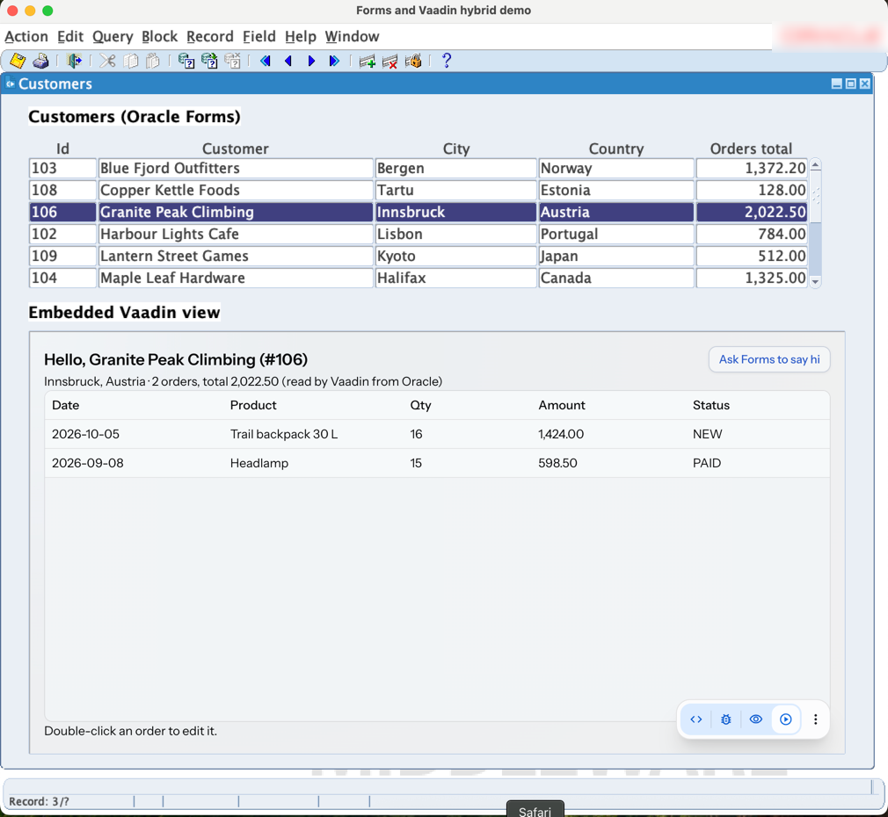
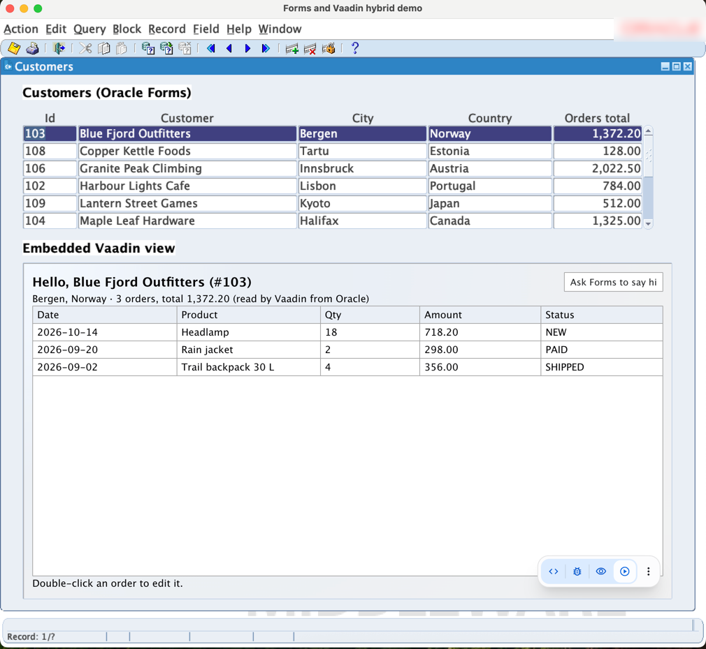

# Forms ↔ Vaadin hybrid demo

An Oracle Forms 12c screen that hosts a live Vaadin view, with calls flowing
both ways. Forms stays the shell while screens move to Vaadin one at a time:
the shape of an incremental migration.

- **Forms → Vaadin:** moving to a customer row in the Forms list pushes
  `<id>|<name>` to the view. The view loads that customer and their **orders**
  from the **same Oracle schema** through its own connection, and shows them in
  a Vaadin Grid.
- **Editing in Vaadin:** double-clicking an order opens a Vaadin Dialog (Date
  Picker, Combo Box, Integer Field, Select). Saving commits the change, then the
  view sends an `orderSaved` event, and the Forms list updates that customer's
  **Orders total** column in place.
- **Vaadin → Forms, simplest case:** the view's "Ask Forms to say hi" button
  sends a `greet` event, and the Forms status bar shows the message.

The bridge is a Forms Pluggable Java Component (a `VBean` in a bean area) that
wraps Vaadin swing-kit's `JVaadinPanel`, an embedded Chromium (JCEF) showing
the Vaadin app. See [ADR-0001](docs/adr/0001-forms-hosts-vaadin-via-swing-kit-bean.md).
Both sides use the same database through separate sessions: each table has one
writer per screen, and the writer tells the other side after it commits. See
[ADR-0003](docs/adr/0003-one-writer-per-table-events-for-refresh.md).

The blog post draft, with architecture diagrams, is in
[docs/blog](docs/blog/incremental-oracle-forms-to-vaadin.md).

## The view's look

The view uses Vaadin's Aura theme configured to look like the Forms screen
around it (`hello-view/src/main/resources/META-INF/resources/oracle-forms-compact.css`):
compact density, square corners, Java's "Dialog" font that Forms uses, the
Forms canvas colour, white fields with thin grey borders, Grid rows as tall as
Forms records with cell borders, the selected row in the Forms current-record
navy, and dialogs with a Forms-like blue title bar. It's plain Aura
configuration, not per-view styling, so other migrated screens get it too.

| Default Aura | Oracle Forms look |
| --- | --- |
|  |  |

Grid rows went from 33 px to 25 px (the Forms record height): the bean area
now fits about 14 orders instead of 10. To compare in a browser, open
http://localhost:8080/?customer=103&theme=default for plain Aura.

## Layout

```
db/           schema.sql: HYBRID user, CUSTOMERS, PRODUCTS, ORDERS and the ORDER_TOTALS view (fictional data)
forms/        hybrid_demo_fmb.xml: the host form (source of truth), build.sh: builds it in the Forms container
contract/     the interface and event names shared by both sides
forms-bean/   the VBean → hybrid-bean.jar (Java 8 bytecode, self-signed)
hello-view/   the embedded Vaadin 25 view (Spring Boot, localhost:8080, JDBC to the same schema)
```

## Prerequisites

This repo contains no Oracle software. You need:

- **An x86_64 (Intel/AMD) machine.** Oracle Forms 12.2.1.4 has no ARM build.
- **Oracle Forms 12.2.1.4 and an Oracle database in Docker.** Set them up with
  [forms-docker-environment](https://github.com/jcgueriaud1/forms-docker-environment):
  you build the Forms image from Oracle's installers (downloaded under Oracle's
  licence terms), then `docker compose up -d`. Its defaults are exactly what
  these scripts expect: containers `frfmw` and `frdb`, domain `FRDEMO`, Forms at
  `http://localhost:7777/forms`, database service `XEPDB1`.
  For another setup, override `HYBRID_FORMS_CONTAINER`, `HYBRID_FORMS_DOMAIN`,
  `HYBRID_FORMS_URL`, `HYBRID_DB_CONTAINER`, `HYBRID_DB_HOST`,
  `HYBRID_DB_SERVICE` and `HYBRID_DB_SYS_PASSWORD`.
- **Java 21 and Maven** on the host, and a **Vaadin subscription or trial**:
  swing-kit is a commercial Vaadin product (see Licence below).

The client launcher picks Java 21 with macOS's `java_home`, else `JAVA_HOME`,
else `java` on the PATH. `run-forms-client.cmd` is the Windows version
(untested).

## Run it

**New machine?** Follow [docs/run-the-demo.md](docs/run-the-demo.md): every
step from an empty x86_64 machine, with checks, timings and troubleshooting.
The short version, once the Forms server is running:

```bash
./setup-db.sh               # create the HYBRID schema
./deploy-bean.sh            # build, self-sign and deploy hybrid-bean.jar
./deploy-form.sh            # build the form, register the [hybrid] config
(cd hello-view && mvn spring-boot:run)   # the embedded view, in its own terminal
./run-forms-client.sh       # the Forms client on Java 21 (Windows: run-forms-client.cmd)
```

The first start downloads JCEF (~300 MB) to `~/.jcef-bundle`. The bean reports
problems on the client's console. For a trace of what it does, start the client
with `JAVA_OPTS=-Dhybrid.debug=true`: the bean then writes `~/hybrid-bean.log`
and swing-kit logs its calls and events (at debug level) on the console.

## Gotchas

- **`@Bridge` on the route.** swing-kit 3.x only adds the `<swing-bridge>`
  element, which receives Swing → Vaadin calls, when the route class has
  `@com.vaadin.swingkit.server.Bridge`. Without it, calls from Forms hang
  silently until the 300 s timeout. Vaadin → Swing events still work, which
  makes this hard to spot.
- **The Forms client JVM.** OpenWebStart ignores the JNLP's Java version and
  runs its bundled Java 8, so the demo uses Oracle's Forms Standalone Launcher
  on Java 21. Each launched config needs `baseSAAfile=basesaa.txt` (FRM-93136
  otherwise). See [ADR-0002](docs/adr/0002-forms-client-on-java-21.md).
- **macOS.** JCEF on Java 17+ needs three `--add-opens` flags
  (`run-forms-client.sh` sets them). It must also start only once the bean is
  on screen and the window has settled, or the AWT and AppKit threads deadlock
  and the client hangs on its splash screen. The bean waits for that.
- **Forms dialogs and the native browser.** Forms draws alerts, LOVs and
  message boxes as lightweight windows inside its own window, and the embedded
  browser is a native component that paints over them. A dialog over the bean
  area would be invisible while Forms waits for an answer. The bean watches for
  other Forms windows over its area and shows a placeholder ("Answer the Forms
  dialog to continue.") instead of the browser until they close. Reproduce with
  `HYBRID_FORMS_PARAMS='&otherparams=alert_test=YES' ./run-forms-client.sh`: an
  alert opens 12 seconds after start.
- **When the Vaadin server is down, slow or restarted, Forms keeps working.**
  The bean checks every 5 s that the server accepts connections (a TCP
  connect, so no Vaadin session per check), and treats a page that fails to
  load, doesn't send its ready event within 15 s, or doesn't answer a call
  within 10 s (swing-kit's default is 300 s) as unavailable. It then shows a
  placeholder in the bean area, and loads the view URL again when the server
  is back; the ready event replays the current customer. Only the latest
  customer is ever pushed, so a slow view never builds up a queue. swing-kit's
  default load-error handling is removed: it opens a modal Swing message box
  (which would block Forms) or its own "Unreachable" page, which its
  `reload()` then reloads instead of the view. Forms itself isn't told: the
  placeholder in the bean area is enough, and the form works without the view.
- **Keyboard between Forms and the browser.** Clicking the browser gives it
  the keyboard, but AWT's focus owner stays on the last Forms item, so keys the
  page doesn't consume (arrows, Tab, Enter) also reached Forms: Down in the
  Vaadin grid moved the Forms record. On macOS, Cmd+C/V/X/A/Z reach AWT, not
  the browser, so they did nothing in Vaadin fields. `BrowserKeyboard` tracks
  who has the keyboard by where the mouse is pressed (AWT reports presses on
  the browser, but not always on the panel's own components), consumes Forms'
  key events while the view has it, and sends the macOS edit shortcuts to the
  browser's focused frame. A page load doesn't take the keyboard from Forms.
- **`Exception in thread "AppKit Thread"` on macOS is harmless.** It's printed
  when the view gets focus. JCEF's `CefClient.onGotFocus` calls
  `browser.setFocus(true)`, which on macOS fires `onGotFocus` again, until a
  `StackOverflowError` ends the loop; focus ends up right. It's a JCEF bug
  (jcefmaven 135); the bean's own focus handler does no work on that stack.
  swing-kit's `Result is missing` warning for `void` calls (`showCustomer`) is
  harmless too.
- **Colours in the form XML.** Use names from Forms' default palette (`white`,
  `r25g25b50`…). Forms XML keeps only colour names, so a custom palette colour
  isn't recreated, and any unknown name renders black.
- **Compiler errors are silent.** `frmcmp` exits 1 with no output when it can't
  log in, and rejects easy-connect strings, so `forms/build.sh` uses a tnsnames
  alias.
- **Character set.** Without `NLS_LANG` the Forms runtime uses US7ASCII, so
  "Łódź" shows as "Lodz". `forms/build.sh` sets AL32UTF8.

## Versions

- swing-kit **3.0.1**: server `vaadin-swing-kit-flow` (Flow 25, Java 21), client
  `vaadin-swing-kit-client` (Java 8 bytecode, JCEF via `me.friwi:jcefmaven`
  135.0.20, Chromium 135)
- Vaadin 25.2, Spring Boot 4.1
- Oracle Forms 12.2.1.4 client on Java 21, through the standalone launcher

## Licence

The code in this repository is under the [Apache License 2.0](LICENSE).

The Vaadin view uses Oracle's JDBC driver (`ojdbc17`), downloaded from Maven
Central at build time under the
[Oracle Free Use Terms and Conditions](https://www.oracle.com/downloads/licenses/oracle-free-license.html).

It uses **Vaadin swing-kit**, a commercial product under the
[Vaadin Commercial License and Service Terms](https://vaadin.com/commercial-license-and-service-terms).
Running the demo needs a Vaadin subscription or trial.

Oracle, Java and Oracle Forms are trademarks of Oracle and/or its affiliates.
This project is not affiliated with or endorsed by Oracle. No Oracle software
is included: `deploy-bean.sh` downloads `frmall.jar` from your own Forms server
at build time, and it is never committed or bundled into the bean jar.
