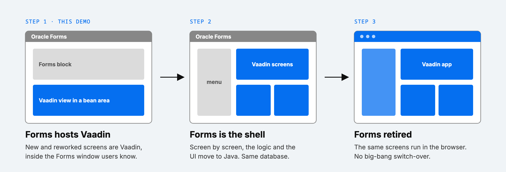
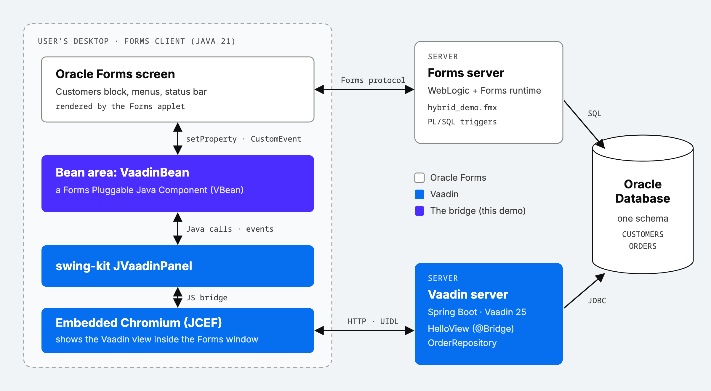
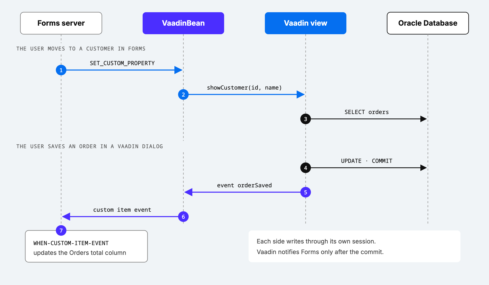

# Migrating Oracle Forms to Vaadin, one screen at a time

Rewriting a large Oracle Forms application in one go is risky: years of
behaviour to rebuild, and a single switch-over day at the end. So we tried the
opposite: keep Forms running, and move screens to Vaadin one at a time, **inside
the Forms window your users already know**.



This post shows step 1 working: a Forms 12c screen with a live Vaadin view
embedded in it, talking both ways and sharing the same Oracle database.


## The architecture



- **The bridge is a Forms bean.** Forms can host custom Java components in a
  *bean area*. Ours wraps Vaadin [Swing Kit](https://vaadin.com/docs/latest/tools/swing)'s
  `JVaadinPanel`, an embedded Chromium that shows the Vaadin view.
- **Two servers, one database.** The Forms server keeps running the PL/SQL.
  The Vaadin server is a plain Spring Boot app with its own connection to the
  same schema.
- **The view is styled like Forms.** An Aura theme configuration with the
  Forms font, colours and density makes it look like part of the screen.

## One round trip



Forms sends the current customer to the bean from a trigger:

```sql
-- WHEN-NEW-RECORD-INSTANCE
SET_CUSTOM_PROPERTY('CONTROL.VAADIN_VIEW', 1, 'CUSTOMER',
                    :customers.id || '|' || :customers.name);
```

The bean calls the view through swing-kit, and turns the view's events into
Forms events (simplified):

```java
public boolean setProperty(ID id, Object value) {
    if (id == CUSTOMER) {
        String[] customer = value.toString().split("\\|", 2);
        panel.as(HelloCallable.class).showCustomer(customer[0], customer[1]);
    }
    ...
}

panel.addEventListener("orderSaved",
        e -> dispatchCustomEvent(new CustomEvent(handler, ORDER_SAVED)));
```

The Vaadin view is a normal route. `@Bridge` makes it callable from the bean:

```java
@Bridge
@Route("")
public class HelloView extends VerticalLayout implements HelloCallable {

    public void showCustomer(String id, String name) { /* load and show orders */ }

    private void save(...) {
        orders.save(...);                        // committed
        emit(new VaadinSwingEventBuilder("orderSaved")
                .addParam("customerId", id).addParam("total", total));
    }
}
```

And Forms picks the event up in `WHEN-CUSTOM-ITEM-EVENT` to update its
**Orders total** column.

## What we learned

- **One writer per table.** Forms and Vaadin use separate database sessions,
  so each table has a single writer per screen, and the writer notifies the
  other side only after its commit.
- **The browser is a native window.** It paints over Forms alerts and takes the
  keyboard differently, so the bean hides the view while a Forms dialog is open
  and routes keys to whichever side the user clicked.
- **Forms must never depend on the view.** If the Vaadin server is down or slow,
  the bean shows a placeholder, keeps Forms working, and reloads the view when
  the server is back.
- **Modern Java works.** The Forms client runs on Java 21 with the Forms
  standalone launcher.

## Try it

The code, the database schema, the form and a step-by-step guide are on
GitHub: [forms-vaadin-hybrid-demo](https://github.com/jcgueriaud1/forms-vaadin-hybrid-demo).
You need an Intel/AMD machine with Docker and the Oracle Forms 12c installers.

## Going further

This hybrid approach keeps users productive while screens move over. For the
screens themselves, see how AI can speed up the rewrite:
[Oracle Forms to Java: a two-week AI migration experiment](https://vaadin.com/blog/oracle-forms-to-java-a-two-week-ai-migration-experiment).

Planning a migration of your own? Our
[Migration Assessment](https://pages.vaadin.com/vaadin-application-assessment-for-migration)
looks at your application and gives you a plan, effort estimate and phasing,
so you can move to a long-term solution safely. We're happy to help.
